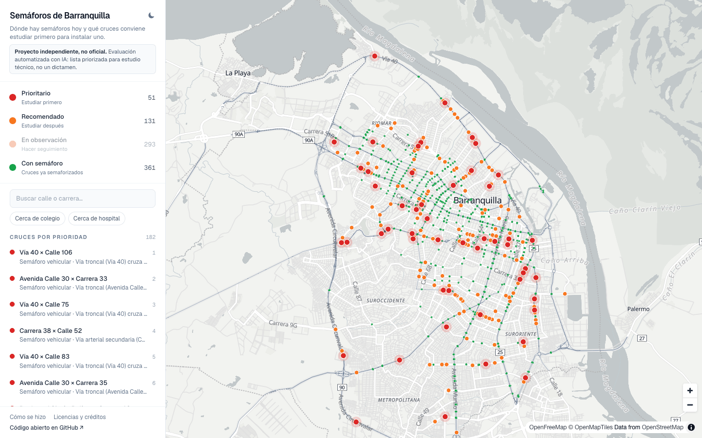
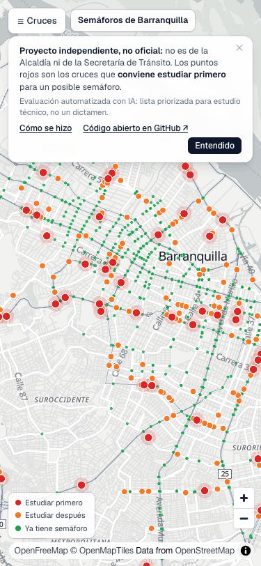

# Semáforos de Barranquilla

**Español** · [English](README.en.md)

Mapa abierto de las calles y los semáforos de Barranquilla, con los cruces que conviene estudiar primero para un
posible semáforo nuevo.

### [Ver el mapa → semaforos-baq.vercel.app](https://semaforos-baq.vercel.app)

<p align="center">
  
  &nbsp;
  
</p>

> **Proyecto ciudadano e independiente.** No es de la Alcaldía de Barranquilla ni de la Secretaría de Tránsito. La
> lista de cruces se hizo con ayuda de inteligencia artificial y es una señal para priorizar estudios técnicos, no un
> dictamen de ingeniería.

## Por qué existe

Viví mi infancia en Barranquilla y hace poco volví a pasar unas semanas aquí con mi familia. Me quedé cerca del
Malecón y salía mucho a caminar, y para eso tenía que cruzar la Vía 40. Aunque hay personal de seguridad vial
dirigiendo el tránsito, cruzarla a pie es dificilísimo. Y manejando por la ciudad me encontré muchos cruces donde
uno esperaría ver un semáforo.

Así que armé este mapa con inteligencia artificial y datos públicos, y lo conté en
[un video en Instagram](https://www.instagram.com/victorpay/reel/Dd7fbzqg02_/). Ahí dije que lo iba a compartir para
que la gente pudiera aportarle o usarlo como base para hacer algo mejor. Este repositorio es eso: el código, los
datos y el método, abiertos.

No soy político, y la idea no es venderle este proyecto a la ciudad. Es mostrar lo que se puede hacer con datos
abiertos y con IA, y que quien tenga mejores datos lo pueda mejorar.

— Victor Pay ([@victorpay](https://www.instagram.com/victorpay/))

## Qué es y qué no es

- **Es** un mapa de las 9.658 intersecciones de Barranquilla, con las 361 que ya tienen semáforo y una lista ordenada
  de cruces que conviene estudiar primero.
- **No es** un dictamen de que haga falta un semáforo. El Manual de Señalización Vial 2024 (cap. 4) exige aforos, es
  decir, conteos de tránsito, para justificar un semáforo, y este proyecto no tiene aforos. Lo que ofrece es una
  forma de decidir **dónde hacer primero** esos estudios.
- **No es** oficial ni está respaldado por ninguna entidad.

En el video dije que en los puntos rojos «se necesita» un semáforo. Lo preciso es esto: son los cruces donde más
indicadores coinciden y donde conviene hacer primero el estudio técnico.

## En números

Corte de los datos: **20 de septiembre de 2026**.

| En el mapa | Nivel | Cruces |
| --- | --- | ---: |
| 🔴 Estudiar primero | Prioritario | **51** |
| 🟠 Estudiar después | Recomendado | **131** |
| 🟡 Hacer seguimiento | En observación | **293** |
| 🟢 Ya tiene semáforo | Con semáforo | **361** |

Base: 9.272 vías y 9.658 cruces de OpenStreetMap; 28.523 siniestros registrados por la policía entre 2018 y junio de
2026, de los cuales 18.797 se pudieron ubicar en un cruce.

## Cómo leer el mapa

- Los colores son los niveles de la tabla anterior. Los amarillos (en observación) empiezan ocultos: toca «En
  observación» en la lista para verlos. En el celular, la lista y la leyenda están en el botón «☰ Cruces».
- Toca un punto para ver su ficha: las calles, la medida sugerida para estudio (por ejemplo, «Semáforo
  vehicular»), si todos los indicadores coinciden, y la **evidencia**: hechos que puedes comprobar, como «24
  siniestros registrados 2018–2022, 6 con heridos» o «Semáforo más cercano a 605 m sobre la Vía 40».
- En la ficha también están las vistas de Google (Street View, satélite y mapa), para que veas el cruce sin ir hasta
  allá.
- «Ver simulación» abre una animación del cruce hoy, con PARE, y con semáforo. Es **ilustrativa**: la forma del
  cruce es real, pero los volúmenes de tránsito son supuestos, porque no hay aforos
  ([más detalles](docs/simulation.md)).

**¿Viste un error?** Si un semáforo falta o sobra, o un candidato no tiene sentido cuando lo ves en la calle, cuéntanos
con el formulario [Corrección de datos](https://github.com/Victorpay1/semaforos-barranquilla/issues/new/choose). Una
foto tuya o un enlace a Street View ayuda mucho.

## Cómo se hizo, en palabras simples

1. **Calles y semáforos.** Se descargaron de [OpenStreetMap](https://www.openstreetmap.org), el mapa libre que
   construyen voluntarios. Con eso se armaron los cruces (las dos calzadas de una avenida cuentan como uno).
2. **Comparación con el inventario oficial.** De los 341 semáforos del inventario de la Secretaría de Tránsito, 339 ya
   estaban en OpenStreetMap.
3. **Siniestros.** Los registros de la policía publicados por la Alcaldía traen la dirección escrita («CL 72 CR 46»),
   no coordenadas. Se ubicaron en un cruce solo cuando la dirección nombra exactamente dos vías y hay un único cruce
   con esos nombres: el 66 % de los registros.
4. **Evaluación con IA.** A un modelo de inteligencia artificial de decisión (Jev, de TypeSafe) se le describe cada
   cruce sin semáforo: qué vías se cruzan, cuántos carriles tienen, a qué distancia está el semáforo más cercano,
   cuántos siniestros hubo, si hay colegios u hospitales cerca. El modelo responde tres preguntas: qué tanta falta
   hace intervenir, qué tan probable es que se justifique un semáforo y qué medida tomaría. Luego se repite **sin
   mostrarle los siniestros**, para tener una segunda opinión independiente.
5. **Reglas propias.** Un cruce es *prioritario* solo si el modelo recomienda semáforo también sin ver los siniestros,
   hay una vía colectora o arterial, es un cruce a nivel (no una glorieta ni un puente), no hay semáforo en la misma
   cuadra, y además tiene muchos siniestros, o un colegio o centro de salud cerca, o un tramo largo sin semáforo.

**¿Qué tan confiable es?** Se probó con los cruces que la ciudad ya semaforizó: al modelo se le describieron como si no
tuvieran semáforo. **De cada 10, la evaluación habría señalado 7; de cada 100 cruces tranquilos, ninguno.** (Son 173
cruces semaforizados y 189 tranquilos que no se usaron para ajustar nada; el umbral se eligió con la otra mitad.)

Eso mide qué tanto se parece la evaluación a lo que la ciudad ya hizo, no si cada semáforo está técnicamente
justificado. La metodología completa, con todos los números, está en [`docs/validation.md`](docs/validation.md).

## Inteligencia artificial: qué se usó y para qué

- **Para programar.** Gran parte del código lo escribieron agentes de programación con IA, siguiendo las
  instrucciones de Victor. El documento con el que se coordinaron está publicado en
  [`docs/history/agent-contract.md`](docs/history/agent-contract.md).
- **Para evaluar los cruces.** Se usó **Jev**, un modelo de decisión de la empresa **TypeSafe** (versión
  `jev-1.13.0`), a través de su API de pago. Sus respuestas se combinan con reglas propias y con los siniestros; el
  modelo no decide solo. Las preguntas exactas están en
  [`scorer-jev/src/questions.ts`](scorer-jev/src/questions.ts) y cómo se usan, en
  [`scorer-jev/README.md`](scorer-jev/README.md). TypeSafe no respalda este proyecto.
- **No necesitas llave para nada más.** Los resultados de la evaluación están en el repositorio, así que el mapa y la
  reconstrucción de los datos funcionan sin pagar. Solo volver a evaluar los cruces requiere una llave de TypeSafe.
- **Las respuestas completas del modelo** (unas 23.000, con sus probabilidades) todavía no se publican, hasta
  confirmar con TypeSafe que se pueden redistribuir.

## Limitaciones

- **No hay aforos.** Sin conteos de tránsito no se puede demostrar ninguna de las condiciones del Manual 2024. Esta es
  una lista para decidir dónde contar primero.
- **Los siniestros son incompletos.** Hay subregistro; desde 2023 no se registran los choques con solo daños; un
  tercio de los registros no se pudo ubicar, sobre todo en la Circunvalar y los intercambiadores. Muchos siniestros
  también pueden significar, simplemente, mucho tránsito.
- **OpenStreetMap es una aproximación.** La clase de cada vía es una estimación de quienes la mapearon; pueden faltar
  colegios, centros de salud o semáforos recientes. Todo candidato debe confirmarse en la calle.
- **El inventario oficial es de sep/oct 2023.** Los semáforos instalados después solo aparecen si ya están en
  OpenStreetMap.
- **El modelo es estadístico.** En la prueba señala 7 de cada 10 cruces que ya tienen semáforo, no 10 de 10, y casi nunca distingue entre semáforo
  peatonal y vehicular; esa decisión corresponde al estudio técnico.
- **La simulación es ilustrativa.** Sus volúmenes de tránsito son supuestos, así que sus cifras sirven para comparar
  las dos vistas, pero no describen lo que pasa hoy en ese cruce.

Detalle en [`docs/validation.md`, sección 6](docs/validation.md#6-limitaciones).

## Datos, fuentes y licencias

| Fuente | Qué aporta | Licencia |
| --- | --- | --- |
| [OpenStreetMap](https://www.openstreetmap.org/copyright) | Calles, cruces, semáforos, colegios, centros de salud, paraderos | ODbL 1.0 |
| Alcaldía Distrital de Barranquilla, «Accidentalidad en Barranquilla», [datos.gov.co `yb9r-2dsi`](https://www.datos.gov.co/d/yb9r-2dsi) | Siniestros viales 2018–2026 | CC BY-SA 4.0 |
| Alcaldía Distrital de Barranquilla, «Semaforización en Barranquilla», [datos.gov.co `svyb-d6ts`](https://www.datos.gov.co/d/svyb-d6ts) | Inventario oficial de semáforos | CC BY-SA 4.0 |
| Jev, de [TypeSafe](https://typesafe.ai) | Evaluación de cada cruce (generada con IA) | publicada bajo ODbL con la base |
| [OpenFreeMap](https://openfreemap.org) © [OpenMapTiles](https://openmaptiles.org) | Mapa base | datos de OpenStreetMap |
| Manual de Señalización Vial 2024, Ministerio de Transporte | Criterios para semaforizar | referencia |

Los datos derivados se publican bajo **ODbL 1.0**; los archivos que re-publican datos de la Alcaldía conservan su
licencia **CC BY-SA 4.0**. La vista de Google Maps solo se enlaza e incrusta: no se copia ningún dato de Google. Qué
contiene cada archivo, de dónde sale y de qué fecha es: [`data/README.md`](data/README.md). Licencias por archivo:
[`data/LICENSE.md`](data/LICENSE.md). En el sitio, la página
[Licencias y créditos](https://semaforos-baq.vercel.app/licencias) resume lo mismo.

Ni la Alcaldía de Barranquilla, ni la Fundación OpenStreetMap, ni TypeSafe respaldan este proyecto.

## Inicio rápido

Necesitas [Node 24 LTS](https://nodejs.org) y Git.

```sh
git clone https://github.com/Victorpay1/semaforos-barranquilla.git
cd semaforos-barranquilla
nvm use              # o instala Node 24 a mano
corepack enable      # activa la versión de pnpm del proyecto
pnpm install
pnpm dev             # abre http://localhost:3000
```

No necesitas ninguna llave ni cuenta.

| Comando | Qué hace | Red | Costo |
| --- | --- | --- | --- |
| `pnpm dev` | El sitio en modo desarrollo | solo el mapa base | — |
| `pnpm build` | Compila el sitio | — | — |
| `pnpm test` / `pnpm lint` / `pnpm typecheck` | Revisiones | — | — |
| `pnpm data` | Reconstruye los datos del mapa desde `data/raw/` | — | — |
| `pnpm run fetch --force` | Descarga de nuevo OpenStreetMap y los siniestros | sí | — |
| `pnpm score` | Vuelve a evaluar los cruces con Jev (`TYPESAFE_API_KEY` en `scorer-jev/.env`) | sí | **de pago** |

## Cómo está armado

Tres paquetes en un solo repositorio:

```
OpenStreetMap ─┐
datos.gov.co ──┴─► pipeline/ ──► data/out/ ──► web/public/data/ ──► web/ (el mapa)
                       ▲             │
                       └─ scorer-jev/ ◄┘   (evaluación con Jev: opcional, de pago)
```

- [`pipeline/`](pipeline/): descarga los datos, arma los cruces, aplica las reglas y produce los archivos del mapa.
- [`scorer-jev/`](scorer-jev/): le hace las preguntas al modelo Jev y corre la prueba contra los cruces ya
  semaforizados.
- [`web/`](web/): el sitio, hecho con Next.js y MapLibre GL. Es estático: no tiene servidor propio, cuentas ni
  *cookies* propias.

Más detalle en [`docs/architecture.md`](docs/architecture.md); los campos de cada archivo, en
[`docs/data-schema.md`](docs/data-schema.md).

## Reproducir los números

```sh
pnpm data
```

Reconstruye todo desde la descarga guardada en `data/raw/`, sin conexión y en segundos. Al final, la comprobación
imprime los conteos por nivel: deben salir `prioritario=51`, `recomendado=131`, `observacion=293` y
`semaforizado=361`. Si cambias algo del pipeline, esos números te dicen qué cambió.

```sh
pnpm run fetch --force    # descarga OpenStreetMap y los siniestros de nuevo
```

Sin `--force`, el script solo baja lo que falta en `data/raw/`. Una descarga nueva da otros resultados, porque
OpenStreetMap cambia cada día.

Volver a evaluar con el modelo es opcional y cuesta dinero (para Barranquilla, del orden de un dólar desde cero). Pon
tu `TYPESAFE_API_KEY` en `scorer-jev/.env`, y también `JEV_MODEL=jev-1.13.0` si quieres la misma versión del modelo
que produjo los resultados publicados. Empieza por la estimación, que no hace ninguna llamada:

```sh
pnpm --filter @semaforos/scorer-jev dry-run   # qué se envía y cuánto costaría, sin conexión
pnpm score                                    # evaluación principal
pnpm score --variant nocrash --collector-only # segunda opinión, sin siniestros
pnpm --filter @semaforos/scorer-jev backtest --variant v3 --choose --role main
pnpm --filter @semaforos/scorer-jev backtest --variant v3nc --choose --role blind
pnpm data
```

Nunca corras `pnpm score` en la integración continua. Detalles y costos en
[`scorer-jev/README.md`](scorer-jev/README.md).

## Trae mejores datos

En el video lo dije: seguro que un funcionario, o quien se encargue de la semaforización, tiene datos mucho más
completos que los que se encuentran en internet. Esto es lo que más mejoraría el mapa:

- **Aforos** (conteos de tránsito) con la ubicación del cruce. Son lo que exige el Manual.
- **El inventario de semáforos actualizado.** El que está publicado en datos abiertos es de 2023.
- **Siniestros con coordenadas**, en lugar de la dirección escrita.
- **Semáforos instalados o en estudio** desde 2023.
- **Rutas y paraderos de Transmetro** en un formato abierto (GTFS).

Si eres de una entidad pública y quieres usar la lista para decidir dónde aforar primero, o si tienes cualquiera de
estos datos, abre un *issue* o escribe por mensaje directo a [@victorpay](https://www.instagram.com/victorpay/). Solo
podemos publicar datos con licencia abierta o con autorización escrita para publicarlos.

## Adapta el proyecto a tu ciudad

No solo Barranquilla: cualquier ciudad con calles en OpenStreetMap puede tener su versión. Hay que cambiar el área de
estudio, el límite municipal, el inventario de semáforos, la fuente de siniestros y cómo se leen sus direcciones, y la
descripción de la ciudad que recibe el modelo. Hoy, sin evaluación con IA, la lista de candidatos sale vacía; un
evaluador abierto que no necesite llave está en la hoja de ruta.

La guía paso a paso está en [`docs/adapta-tu-ciudad.md`](docs/adapta-tu-ciudad.md). Ponle otro nombre a tu versión
(ver [`TRADEMARKS.md`](TRADEMARKS.md)), y si quieres, cuéntanos con el formulario
[Adaptar a mi ciudad](https://github.com/Victorpay1/semaforos-barranquilla/issues/new/choose).

## Cómo contribuir

No hace falta programar. Puedes reportar un dato equivocado, agregar un semáforo que falta en OpenStreetMap, revisar
candidatos en Street View o traducir la documentación. Si programas, busca los *issues* marcados `good first issue`.

Dos retos abiertos, para quien quiera algo más grande:

- **Un evaluador abierto** que no dependa de un modelo de pago y supere la prueba actual: señalar más de 7 de cada 10
  cruces ya semaforizados sin señalar ningún cruce tranquilo.
- **Unir los aforos de la Secretaría** (archivos de Excel por cruce, sin coordenadas) a los cruces del mapa.

Todo está en [`CONTRIBUTING.md`](CONTRIBUTING.md). Cada *commit* se firma con `git commit -s` (DCO). Al participar
aceptas el [Código de Conducta](CODE_OF_CONDUCT.md). Para problemas de seguridad, ver [`SECURITY.md`](SECURITY.md).

## Hoja de ruta

Son ideas, sin fechas comprometidas; cualquiera puede tomar una.

Lo próximo:

- Evaluador abierto (sin llave) para otras ciudades y para comparar con Jev.
- Botón «Reportar un error en este cruce» en la ficha de cada cruce.
- Descargar la lista de candidatos en CSV.
- Enlace directo a un cruce, para compartirlo.

Más adelante:

- Incorporar aforos y un inventario de semáforos actualizado.
- Actualizar los datos de forma periódica, con cada cambio anotado en el [`CHANGELOG.md`](CHANGELOG.md).
- Municipios vecinos del área metropolitana (Soledad, Puerto Colombia) y otras ciudades.
- Publicar las respuestas completas del modelo, si TypeSafe lo permite.

## Créditos

- Idea, dirección y mantenimiento: Victor Pay ([@victorpay](https://www.instagram.com/victorpay/)).
- Datos de calles y semáforos: © colaboradores de [OpenStreetMap](https://www.openstreetmap.org/copyright).
- Siniestros e inventario de semáforos: Alcaldía Distrital de Barranquilla y su Secretaría de Tránsito y Seguridad
  Vial, en el Portal de Datos Abiertos [datos.gov.co](https://www.datos.gov.co).
- Mapa base: [OpenFreeMap](https://openfreemap.org) © [OpenMapTiles](https://openmaptiles.org).
- Evaluación: modelo Jev de [TypeSafe](https://typesafe.ai), usado a través de su API.
- Construido con [MapLibre GL JS](https://maplibre.org) y [Next.js](https://nextjs.org).
- Las fuentes de la investigación (Manual de Señalización Vial 2024, MUTCD, estudios de comportamiento en cruces)
  están citadas en [`docs/research/`](docs/research/).

## Licencia

**Semáforos de Barranquilla** es un proyecto creado por Victor Pay: el código es abierto bajo licencia Apache 2.0, los
datos bajo ODbL 1.0 (© colaboradores de OpenStreetMap; incluye datos de la Alcaldía de Barranquilla vía datos.gov.co)
y la documentación bajo CC BY 4.0, así que puedes usarlo, mejorarlo y construir sobre él, incluso con fines
comerciales, siempre que des crédito al proyecto original; el nombre y el logo no están incluidos en esas licencias
(ver [`TRADEMARKS.md`](TRADEMARKS.md)) y el único sitio oficial es https://semaforos-baq.vercel.app.

| Qué | Licencia | Archivo |
| --- | --- | --- |
| Código | Apache-2.0 | [`LICENSE`](LICENSE), [`NOTICE`](NOTICE) |
| Datos derivados de OpenStreetMap | ODbL 1.0 | [`data/LICENSE.md`](data/LICENSE.md) |
| Datos re-publicados de la Alcaldía (siniestros por cruce, inventario oficial) | CC BY-SA 4.0 | [`data/LICENSE.md`](data/LICENSE.md) |
| Documentación | CC BY 4.0 | [`docs/LICENSE.md`](docs/LICENSE.md) |
| Nombre y logo | sin licencia | [`TRADEMARKS.md`](TRADEMARKS.md) |

## Cómo citar

GitHub muestra «Cite this repository» a partir de [`CITATION.cff`](CITATION.cff). En texto:

> Pay, V. (2026). *Semáforos de Barranquilla* (versión 0.1.0) [Software y base de datos].
> https://github.com/Victorpay1/semaforos-barranquilla

Para prensa: puedes usar capturas del mapa con el crédito «Semáforos de Barranquilla / Victor Pay · © colaboradores de
OpenStreetMap». Cómo citar solo los datos: [`data/README.md`](data/README.md#cómo-citar-los-datos).
