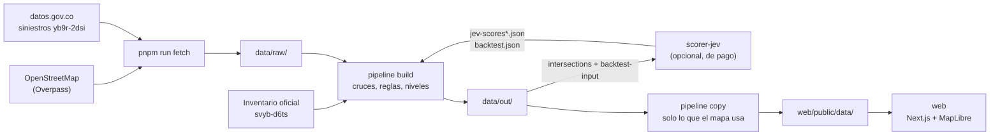

# Cómo está armado / Architecture

*English summary at the end.*

Un solo repositorio con tres paquetes de TypeScript en un *workspace* de pnpm (Node 24 LTS):

| Carpeta | Paquete | Qué hace | Red | Llave |
| --- | --- | --- | --- | --- |
| `pipeline/` | `@semaforos/pipeline` | Descarga OpenStreetMap y los siniestros, arma los cruces, aplica las reglas y produce los datos del mapa | solo `pnpm run fetch` | no |
| `scorer-jev/` | `@semaforos/scorer-jev` | Hace las preguntas de la evaluación al modelo Jev (TypeSafe) y corre la prueba contra los cruces ya semaforizados | sí | sí, de pago |
| `web/` | `@semaforos/web` | El sitio: Next.js + MapLibre GL, sin servidor propio | solo en el navegador | no |

## Flujo de datos

1. **`pnpm run fetch`** (`pipeline/src/fetch.ts`, `crashes.ts`) descarga las vías, los semáforos, los puntos de interés y
   el límite municipal desde Overpass, y los registros de siniestros desde la API de datos.gov.co. Guarda todo en
   `data/raw/` y no vuelve a descargar lo que ya está. Una descarga nueva da otros resultados, porque OpenStreetMap
   cambia cada día.
2. **`pnpm data`** corre tres pasos sin conexión:
   - `build` arma los cruces (nodos compartidos por dos o más vías; las dos calzadas de una avenida cuentan como un
     cruce), los compara con el inventario oficial de semáforos, asigna los siniestros por dirección, calcula las
     reglas y combina todo con la evaluación guardada en `data/out/jev-scores*.json` para asignar el nivel
     (prioritario, recomendado, en observación). Escribe la base completa en `data/out/`.
   - `copy` deja en `web/public/data/` solo los cruces que el mapa dibuja y solo los campos que la interfaz lee.
   - `verify` revisa que todo cuadre (cruces dentro del área, sin duplicados, evidencia en lenguaje claro, ningún
     cruce de la lista a menos de 80 m de un semáforo, etc.) y falla si algo no.
3. **`pnpm score`** (opcional, de pago) lee `data/out/intersections.geojson`, hace tres preguntas por cruce a la API
   de TypeSafe y escribe `data/out/jev-scores.json`. Cada respuesta se guarda en `scorer-jev/cache/` (ignorada por git)
   para no pagar dos veces la misma pregunta. El *backtest* (`pnpm --filter @semaforos/scorer-jev backtest`) evalúa
   `data/out/backtest-input.json` y escribe `data/out/backtest.json`, de donde salen los umbrales.
4. **`web/`** es un sitio estático: carga los archivos de `web/public/data/` desde el mismo dominio, el mapa base desde
   OpenFreeMap y, cuando abres un cruce, la vista de calle desde Google Maps. No tiene base de datos, cuentas ni
   llaves.

Los resultados de la evaluación están en el repositorio, así que los pasos 2 y 4 funcionan sin llave y sin pagar
nada. Sin esos archivos, hoy la lista de candidatos sale vacía (ver [`adapta-tu-ciudad.md`](adapta-tu-ciudad.md)).

## Archivos que conviene conocer

| Archivo | Para qué |
| --- | --- |
| `pipeline/src/config.ts` | Área de estudio, rutas, radios y distancias |
| `pipeline/src/build.ts` | Construcción de cruces y niveles |
| `pipeline/src/priority.ts` | Reglas de cada nivel |
| `pipeline/src/streetkeys.ts` | Cómo se leen las direcciones de los siniestros (Murillo = Calle 45, etc.) |
| `pipeline/src/verify.ts` | Comprobaciones automáticas |
| `scorer-jev/src/questions.ts` | Las preguntas que se le hacen al modelo (variante en uso) |
| `scorer-jev/README.md` | Cómo funciona el evaluador, costos y la prueba |
| `web/lib/data.ts` | Carga de datos en el navegador |
| `web/lib/sim.ts` | La simulación de cada cruce |
| `web/components/` | Mapa, lista lateral, ficha del cruce, simulación |

Los campos de cada archivo están en [`data-schema.md`](data-schema.md).

---

## English summary

One repository, three TypeScript packages in a pnpm workspace (Node 24 LTS): `pipeline/` (downloads OpenStreetMap and
crash records, builds junctions, applies rules, produces the map data), `scorer-jev/` (asks the Jev decision model by
TypeSafe three questions per junction, and runs the backtest against already-signalized junctions; network, paid key)
and `web/` (Next.js + MapLibre GL static site; no server, no database, no keys).

`pnpm run fetch` downloads raw data into `data/raw/`. `pnpm data` runs `build` → `copy` → `verify` offline: it builds
junctions, matches the official signal inventory and crash addresses, combines rules with the committed model scores
(`data/out/jev-scores*.json`) into tiers, writes the full database to `data/out/`, and copies only what the map needs
to `web/public/data/`. `pnpm score` (optional, paid) re-scores junctions and caches every answer in
`scorer-jev/cache/` (git-ignored). Because the scores are committed, everything except re-scoring works with no key.
Without them, the candidate list is empty today (see [`adapta-tu-ciudad.md`](adapta-tu-ciudad.md)). Field
definitions are in [`data-schema.md`](data-schema.md).
